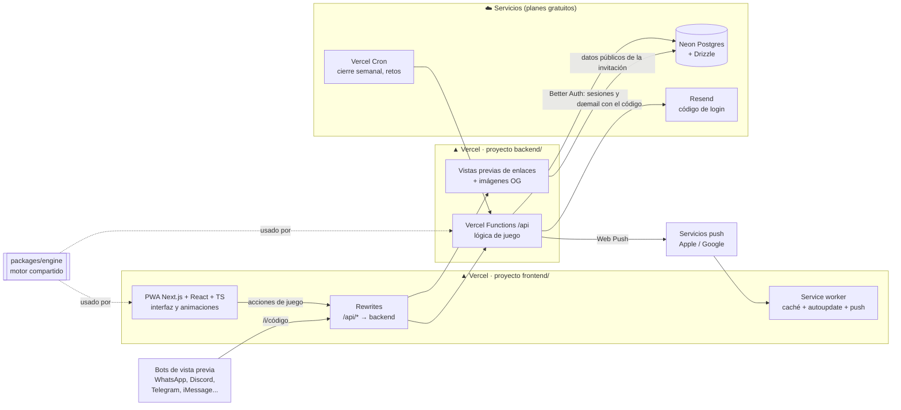
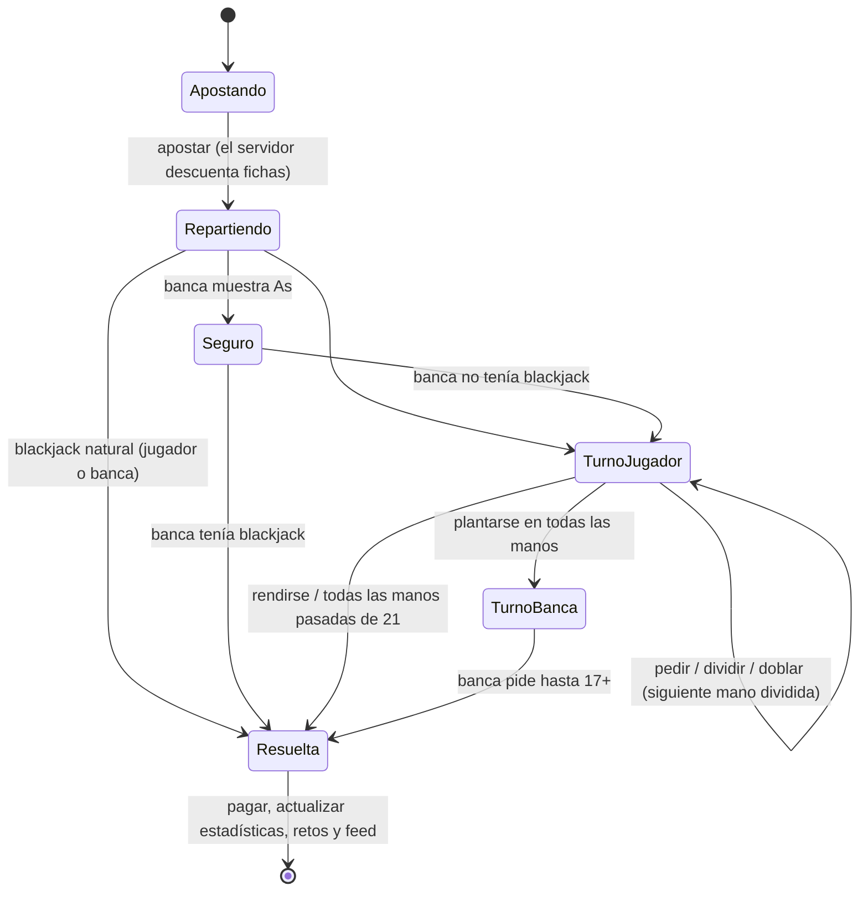
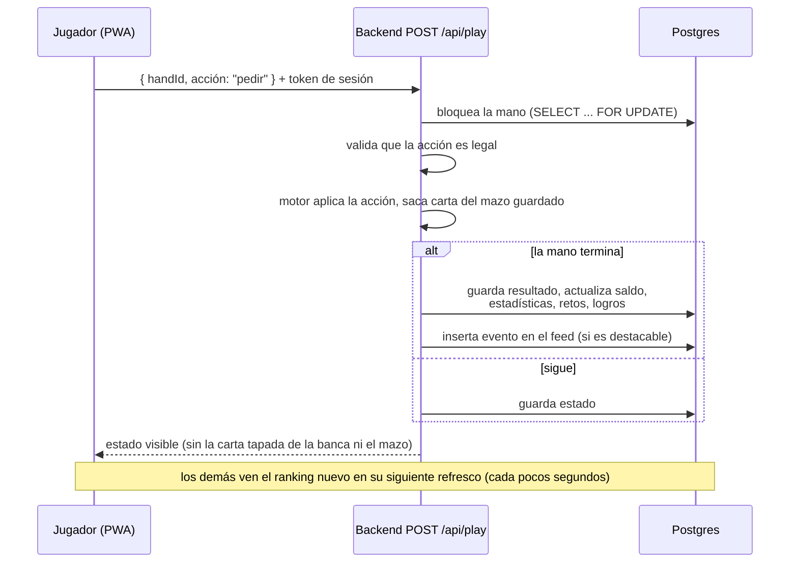
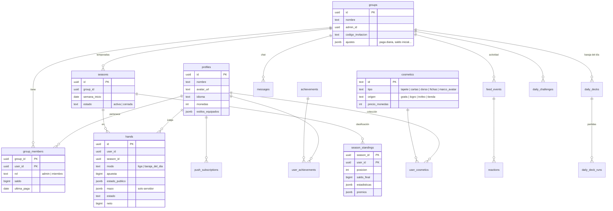
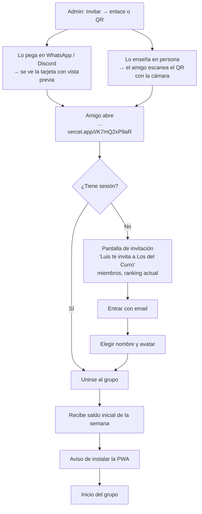
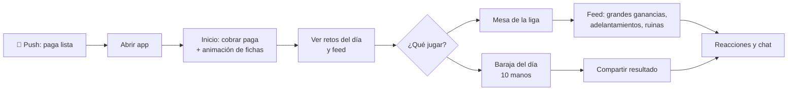
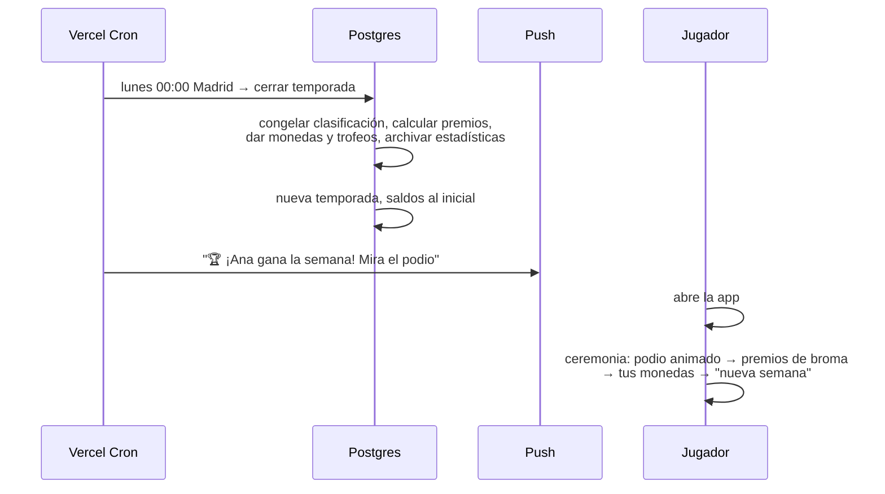

# Blackjack with Friends: documento de diseño

> Estado: **v2, decisiones confirmadas**. Los valores marcados con 🔧 son propuestas que no se han confirmado expresamente y se pueden ajustar durante la beta.

## 1. Concepto

Una **liga semanal de blackjack entre amigos**. Cada jugador juega **solo contra la banca**, a su ritmo, cuando quiera. Lo que se comparte es la competición:

- Cada grupo de amigos tiene su **liga**, con su propio saldo de fichas por jugador.
- Cada día recibes una **paga diaria** de fichas que se suma a tu saldo.
- El **domingo a medianoche** se cierra la semana: gana quien tenga **más fichas**. Hay ceremonia con podio, premios de broma y trofeo para el ganador.
- El lunes empieza un **ciclo nuevo**: todos vuelven al saldo inicial y las estadísticas quedan guardadas.
- Extras: **Baraja del día** (todo el grupo juega las mismas cartas, estilo Wordle) y **retos y logros**.
- Lo social: feed de actividad, reacciones, chat de grupo y notificaciones push.
- Progresión permanente: **monedas** (distintas de las fichas) para desbloquear **estilos** de tapete, cartas, etc.

### Dos monedas, dos propósitos

| | **Fichas** 🟢 | **Monedas** 🪙 |
|---|---|---|
| Para qué | Apostar y competir en la liga | Comprar cosméticos en la tienda |
| Ámbito | Por grupo | Por usuario (global) |
| Duración | Se reinician cada semana | Permanentes |
| Cómo se ganan | Paga diaria, ganar manos, retos diarios | Quedar en el podio semanal, logros |

Separarlas es clave: gastar en la tienda **nunca** te baja en el ranking.

---

## 2. Reglas del juego

### Blackjack (reglas completas)
- 🔧 6 barajas, **barajado nuevo en cada mano** (equivale a una barajadora continua: no se pueden contar cartas).
- La banca **se planta en 17 suave** (S17).
- Blackjack paga **3:2**.
- **Doblar** con cualquier par de cartas iniciales, también después de dividir.
- **Dividir** hasta 3 veces (4 manos). Los ases divididos reciben una sola carta.
- **Seguro** cuando la banca muestra un As (paga 2:1).
- **Rendirse** (tardío): recuperas la mitad de la apuesta.
- Sin límite de tiempo: si cierras la app a mitad de mano, la retomas donde la dejaste.

### Economía de la liga
- Saldo inicial cada lunes: **1.000 fichas**.
- Paga diaria: **+1.000 fichas**, se cobra con un botón (no caduca dentro de la semana: si no entras el martes, el miércoles cobras 2).
- 🔧 Apuesta mínima **10**. Máxima: **todo tu saldo** (el all-in está permitido).
- Si te quedas a 0, esperas a la paga del día siguiente.
- Cierre de semana: **domingo 23:59, hora de Madrid**.
- **Quien entra a mitad de semana** recibe el saldo inicial más **todas las pagas de los días ya transcurridos** (incluido el de hoy). Empieza con lo mismo que habría tenido alguien que entró el lunes y no jugó.

### Premios semanales (monedas)
- 1º: **100** 🪙 + trofeo · 2º: **60** 🪙 · 3º: **30** 🪙 · Haber jugado al menos 1 día: **10** 🪙.
- Premios de broma (solo para presumir, sin monedas): más blackjacks, apuesta más loca, peor racha, más manos jugadas, "rey del seguro"...

### Baraja del día
- Todos los jugadores del grupo juegan **las mismas cartas** ese día (misma semilla).
- **10 manos**, saldo virtual de 1.000 aparte de la liga y la misma apuesta fija de 100 por mano, para que solo cuenten las decisiones.
- Clasificación diaria propia. Premio para el 1º del día: **+500 fichas** en la liga.
- Al terminar, puedes compartir el resultado en el grupo, estilo Wordle: `🃏 Baraja del día #42 · +650 · 🟩🟩🟥🟩⬜🟩🟥🟩🟩🟩`.
- Hasta que acabas tus 10 manos no ves las de los demás, para que nadie te haga spoiler.

### Retos y logros
- **Retos diarios**: 3 al día, iguales para todo el grupo (p. ej. "gana 3 manos seguidas", "haz un split ganador", "gana con 5 cartas"). Cada uno da 🔧 **+200 fichas**.
- **Logros** permanentes con insignia en el perfil y algunos con cosmético o monedas de premio (p. ej. "Primer blackjack", "Gana una semana", "10 semanas en el podio", "Sobrevive con 1 ficha").

---

## 3. Arquitectura

### Decisión principal: el servidor reparte las cartas
El navegador **nunca** decide las cartas ni calcula premios. Solo envía acciones ("pedir", "plantarse"...) y muestra lo que el servidor responde. Así nadie puede hacer trampas tocando el código del navegador.

### Componentes



### Tecnologías

| Pieza | Elección | Por qué |
|---|---|---|
| Frontend | Next.js 16 (App Router, Turbopack) + React 19 + TypeScript | Rutas por carpetas, metadatos y vistas previas de enlaces en el propio frontend |
| Rutas | App Router de Next.js | La app es cliente tras el login; el servidor solo sirve HTML, metadatos e imágenes OG |
| Datos del servidor | TanStack Query contra nuestra `/api` | Caché, reintentos y refresco periódico (en vez de tiempo real) |
| Animaciones | Motion (antes Framer Motion) | Cartas volando, fichas, podio |
| Sonido | Howler.js | Fiable en iOS y fácil de silenciar |
| Idiomas | i18next (es + en) | Desde el día 1 |
| Backend (API) | Vercel Functions en Node/TypeScript, en la carpeta `backend/` | La lógica de juego y las vistas previas, en un proyecto de Vercel aparte |
| Base de datos | Neon Postgres (desde el Marketplace de Vercel) + Drizzle ORM | Postgres estándar: sin atarnos a un proveedor; migraciones en el repo |
| Login | Better Auth con código de 6 cifras por email (sin contraseñas) | Librería, no servicio: usuarios y sesiones en nuestra BD, cookie en nuestro dominio |
| Emails | Resend | Envío fiable y gratis hasta 3.000 al mes; necesita un dominio verificado para escribir a cualquiera |
| Tareas programadas | Vercel Cron llamando a la API | Sin servicios extra |
| Avatares | Generados (inicial y color); fotos más adelante con Vercel Blob | Nada que alojar al principio |
| Hosting | Dos proyectos de Vercel: el frontend (`blackjack-con-amigos.vercel.app`) y el backend (`blackjackwithfriends-backend.vercel.app`) | HTTPS gratis (necesario para la PWA). El frontend reenvía `/api` al backend, así que no hay CORS |
| Vistas previas de enlaces | `generateMetadata` + `opengraph-image` de Next.js (`next/og`) | El HTML de cada invitación ya sale del servidor con sus metadatos e imagen |
| Códigos QR | Librería `qrcode`, generada en el navegador | Sin servidor y funciona sin conexión |
| Push | Web Push con claves VAPID desde el backend | En iPhone solo funciona con la app instalada (iOS 16.4+) |
| Tests | Vitest | Sobre todo para el motor de blackjack |

### Motor de blackjack compartido
Un único paquete TypeScript **puro**, sin dependencias, en `packages/engine/` (`@bwf/engine`). Lo usan:
- el **backend**, que es la autoridad: reparte, valida acciones y calcula pagos;
- el **cliente**, solo para mostrar (valor de la mano, qué botones están activos).

Se prueba a fondo con tests unitarios: todas las reglas y casos raros.

### Estado de una mano (máquina de estados)



Cada mano se guarda en la base de datos en cada paso. Si se recarga la app (por ejemplo, por una actualización automática), la mano sigue exactamente donde estaba.

### Flujo de una acción de juego



El mazo de cada mano se guarda en el servidor y **nunca se envía al cliente**. La carta tapada de la banca solo se envía cuando se descubre.

### Tareas programadas (Vercel Cron)

| Cuándo | Qué |
|---|---|
| Cada hora | Comprueba si en Madrid ya es lunes 00:00 para cerrar las semanas. Se ejecuta cada hora para no depender del cambio de horario. |
| Cierre de semana | Calcula el podio, los premios de broma, las monedas y los trofeos. Archiva las estadísticas, reinicia los saldos y crea la nueva temporada. |
| Diario 00:00 Madrid | Genera la semilla de la Baraja del día y los 3 retos diarios de cada grupo. |
| Domingo 21:00 | Push: "Quedan 3 horas para el cierre de la liga". |

La paga diaria **no** usa cron: se calcula al cobrarla, según los días que han pasado. Es más sencillo y no falla si el cron se retrasa.

---

## 4. Modelo de datos



Notas:
- **Solo el backend toca la base de datos**: la app nunca se conecta a ella. Cada ruta de la API comprueba la sesión y que eres miembro del grupo, así que solo ves los datos de tus grupos. Los saldos, manos y monedas **solo** los cambia el backend.
- El campo `cosmetics.origen` deja la puerta abierta a añadir más adelante un origen "compra" sin cambiar nada más. **No hay ninguna huella visible de esto en la app.**

---

## 5. Flujos de usuario

### Primera vez: invitación → jugando



Quien llega a mitad de semana empieza con el saldo inicial más las pagas de los días ya transcurridos (ver [Economía de la liga](#economía-de-la-liga)).

### Bucle diario



### Cierre semanal



---

## 6. Diseño UI / UX

### Principios
- **Móvil primero, en vertical**, y usable con una mano: las acciones principales quedan en el tercio inferior.
- **Estilo base moderno oscuro**: fondo casi negro, superficies con un ligero efecto de cristal, un color de acento y tipografía limpia. Es neutro para que cualquier tapete elegido quede bien.
- **Mucho "juice"**: cartas que vuelan desde el mazo, fichas que se apilan y saltan al ganar, confeti en los blackjacks, números que cuentan hacia arriba, sonidos y vibración. Todo se puede silenciar en Ajustes.
  - En iPhone, el navegador no permite vibrar desde una web; solo vibra en Android.
- Respetar "reducir movimiento" del sistema: si está activado, las animaciones se acortan.
- Español e inglés desde el inicio.

### Navegación

Barra inferior con 5 pestañas. El botón central **Jugar** es más grande. Arriba, un **selector de grupo** si perteneces a varios.

```
┌─────────────────────────────┐
│ Los del Curro ▾      🪙 240 │  ← selector de grupo · monedas
│                             │
│          (pantalla)         │
│                             │
├─────────────────────────────┤
│  🏠    🏆    (🃏)    💬   👤 │
│ Inicio Ranking Jugar Social Perfil
└─────────────────────────────┘
```

### Pantallas

**Inicio (resumen del grupo)**
```
┌─────────────────────────────┐
│ Los del Curro ▾      🪙 240 │
│ ┌─────────────────────────┐ │
│ │ Tu saldo      12.450 🟢 │ │
│ │ 2º de 6  ▲1   ⏱ 2d 14h  │ │
│ │ [ 💰 Cobrar paga +1.000 ]│ │
│ └─────────────────────────┘ │
│ Top 3: 🥇 Ana 15.200        │
│        🥈 Tú  12.450        │
│        🥉 Luis 9.800        │
│ ┌ Retos de hoy ───── 1/3 ┐ │
│ │ ✅ Gana 3 seguidas      │ │
│ │ ⬜ Split ganador  +200  │ │
│ └─────────────────────────┘ │
│ [🃏 Baraja del día #42  ▶ ] │
│ Feed ─────────────────────  │
│ Luis ganó 4.000 con BJ 🔥3  │
│ Marta se arruinó 💀5        │
├─────────────────────────────┤
│  🏠    🏆    (🃏)    💬   👤 │
└─────────────────────────────┘
```

**Mesa**: el tapete, las cartas, el dorso y las fichas cambian con los estilos elegidos.
```
┌─────────────────────────────┐
│ ←  Liga       12.450 🟢  🔊 │
│                             │
│       BANCA   [🂠][K♥]      │
│                             │
│      ░░░ tapete ░░░         │
│                             │
│    [A♠][7♦]   = 18 / 8      │
│      apuesta: 500           │
│                             │
│ [Rendirse] [Seguro]         │
│ [ Pedir ] [Plantarse]       │
│ [ Doblar ] [ Dividir ]      │
└─────────────────────────────┘
```
Al apostar, se toca sobre fichas de 10 / 50 / 100 / 500 / 1.000. También hay botones de "repetir apuesta", "x2" y "all-in".

**Ranking**: la clasificación en vivo con la variación del día (▲▼). Debajo, el historial de semanas pasadas y la clasificación de la Baraja del día.

**Social**: dos subpestañas, **Feed** (con reacciones) y **Chat** del grupo.

**Perfil**:
- Estadísticas: manos jugadas, % de victorias, blackjacks, mayor ganancia, semanas ganadas.
- Vitrina de trofeos y logros.
- Acceso a **Estilos**.

**Estilos y tienda**: una cuadrícula por tipo (tapete, cartas, dorso, fichas, marco de avatar). Cada elemento está equipado, disponible o bloqueado; si está bloqueado, se indica cómo conseguirlo ("Gana una semana" o "150 🪙").

**Ceremonia semanal**: a pantalla completa y en secuencia: redoble → 3º → 2º → 1º con confeti → premios de broma → "has ganado X 🪙" → "¡Nueva semana!".

**Ajustes**: idioma, sonido, vibración, notificaciones (por tipo) y cerrar sesión. Si eres admin, también los ajustes del grupo: paga diaria, saldo inicial, expulsar miembros y renovar el enlace de invitación.

### Cosméticos iniciales (propuesta)
- **Gratis** (los "pochos"): tapete verde básico, cartas clásicas y dorso rojo.
- **Logros**: p. ej. tapete "Medianoche" por 100 blackjacks, o dorso "Kamikaze" por ganar un all-in.
- **Trofeos**: tapete dorado "Campeón" al ganar 1 semana, o marco de avatar con laurel al ganar 5.
- **Tienda** (🪙): unos 15 estilos variados, como neón, madera, pixel-art, minimalista o retro.

---

## 7. Lado social

| Función | Detalle |
|---|---|
| Grupos | El creador es admin. Se entra por enlace de invitación (renovable). Puedes estar en varios grupos, cada uno con su saldo. |
| Feed | Eventos automáticos destacables: blackjack con apuesta alta, ganancia o pérdida grande, adelantamiento en el ranking, ruina, reto o logro completado, resultado de la Baraja del día. |
| Reacciones | 🔥 😂 💀 👏 😱 en cada evento del feed. |
| Chat | Texto y emojis; se refresca cada pocos segundos mientras está abierto. Se pueden citar eventos del feed. |
| Push | Paga lista (si no has cobrado a las 🔧 18:00), te han adelantado, mención en el chat, quedan 3 h de liga y ceremonia lista. Cada tipo se activa o desactiva por separado. |
| Compartir fuera | Resultado de la Baraja del día y podio semanal como texto o imagen para WhatsApp. |

Moderación mínima: el admin puede expulsar miembros y cualquiera puede borrar sus propios mensajes.

### Invitar: enlace con vista previa y QR

**Pantalla "Invitar"** (desde el Inicio del grupo o desde sus ajustes):
```
┌─────────────────────────────┐
│ ←  Invitar a Los del Curro  │
│                             │
│      ┌───────────────┐      │
│      │ ▀▄█▀▄ ▄▀█▄▀▄  │      │
│      │ █▄▀ [🃏] ▀▄█  │      │  ← QR con el icono de la app en el centro
│      │ ▄▀█▄▀▄ █▀▄▀█  │      │
│      └───────────────┘      │
│   Escanéalo con la cámara   │
│                             │
│ …vercel.app/i/K7mQ2xP9aR    │
│ [ 📤 Compartir ] [ 📋 Copiar]│
│ [ ⬇️ Guardar QR como imagen ]│
│                             │
│ Admin: [ 🔄 Renovar enlace ] │
└─────────────────────────────┘
```
- **Compartir** abre el menú nativo del móvil (WhatsApp, Telegram...). Si no está disponible, copia el enlace.
- El **QR** se genera en el propio navegador con el estilo oscuro de la app y el icono en el centro. Se puede guardar como imagen.
- Para escanearlo no hace falta lector dentro de la app: basta la cámara del móvil, que abre el enlace.
- **Renovar enlace** invalida el anterior (y su QR). Sirve si se ha filtrado.

**Vista previa del enlace** (la tarjeta que aparece al pegarlo en WhatsApp, Discord, Telegram, iMessage, X...):

```
┌──────────────────────────────────────────┐
│ Blackjack with Friends                    │
│ Luis te invita a «Los del Curro» 🃏        │  ← og:title
│ 6 jugadores · Semana 12 · Líder: Ana       │  ← og:description
│ ┌──────────────────────────────────────┐ │
│ │  [tapete verde]                       │ │
│ │   LOS DEL CURRO                       │ │  ← og:image 1200×630
│ │   (avatares de los miembros)          │ │     generada al vuelo
│ │   🥇 Ana 15.200 🥈 Pablo 12.450 🥉 …   │ │
│ │   ¡Únete a la liga!         🃏 logo    │ │
│ └──────────────────────────────────────┘ │
└──────────────────────────────────────────┘
```

Cómo funciona:
- Los bots que generan la vista previa **no ejecutan JavaScript**: solo leen las etiquetas `<meta>` del HTML que devuelve el servidor.
- Por eso, las rutas que se comparten (`/i/[código]`) son páginas de Next.js renderizadas en el servidor, fuera del grupo `(app)` que exige login:
  1. Pide al backend los datos públicos de la invitación (nombre del grupo, quién invita, número de miembros y top 3) mediante una función de solo lectura que no expone nada más.
  2. `generateMetadata` rellena las etiquetas Open Graph y de Twitter. Para una persona, la app carga con normalidad. Para un bot, la tarjeta queda bonita.
  3. `og:image` sale de `opengraph-image.tsx` en esa misma ruta, que dibuja la imagen 1200×630 con `next/og`.
- En Discord, el color de la barra lateral de la tarjeta sale de `theme-color`.
- Las respuestas se guardan en caché unos minutos, para no consultar la BD cada vez que alguien pega el enlace.
- **Página principal y enlaces genéricos**: tarjeta estática con el logo y "Tu liga semanal de blackjack con amigos".
- **Otros enlaces compartibles** que reutilizan el mismo sistema: el resultado de la Baraja del día (`/r/…`) y el podio semanal (`/p/…`), cada uno con su imagen generada.

Privacidad y seguridad:
- Cualquiera con el enlace ve en la vista previa el nombre del grupo, los nombres del top 3 y el número de miembros. Por eso:
  - el código es **largo y aleatorio** (10 caracteres), para que no se pueda adivinar;
  - el admin puede **renovarlo**;
  - 🔧 hay un ajuste de grupo para **ocultar el ranking en la vista previa** (solo nombre del grupo y número de miembros).
- Si el código no existe o se ha renovado, la tarjeta es la genérica y la página dice "Invitación caducada, pídele otra a tu amigo".

---

## 8. Fases de desarrollo

Cada fase termina con algo usable y desplegado.

| # | Fase | Resultado |
|---|---|---|
| 0 | ✅ PWA base | Instalación con aviso y botón, y actualización automática |
| 1 | ✅ Fundaciones | Base de datos Neon + Drizzle; login con código por email (Better Auth + Resend); i18n; estilo base oscuro; navegación con pestañas; despliegue en Vercel; tarjeta de vista previa estática para la página principal |
| 2 | ✅ Motor de blackjack | Módulo puro con todas las reglas y una batería completa de tests |
| 3 | Mesa jugable | endpoint `POST /api/play` del backend, manos guardadas en BD y mesa con animaciones básicas, todavía con un saldo de prueba |
| 4 | Grupos y liga | Crear grupo, unirse, saldo por grupo, paga diaria, ranking en vivo y admin |
| 4b | Invitaciones | Pantalla "Invitar" con compartir, copiar y **QR**; **vista previa del enlace** con imagen generada (`next/og`); renovar el enlace |
| 5 | Ciclo semanal | Cierre automático, ceremonia, estadísticas, trofeos y monedas |
| 6 | Social | Feed, reacciones y chat |
| 7 | Notificaciones push | Suscripción, preferencias y envíos |
| 8 | Retos y logros | Retos diarios y logros con insignias |
| 9 | Baraja del día | Semilla diaria, 10 manos, clasificación y compartir (con su vista previa `/r/…`) |
| 10 | Estilos y tienda | Sistema de temas para la mesa, colección, tienda y selector |
| 11 | Juice y pulido | Sonidos, más animaciones, vibración, accesibilidad y rendimiento |
| 12 | Beta con amigos | Probar con un grupo real, ajustar la economía y corregir errores |

Para empezar a probar con amigos de verdad bastan las fases 1–5 (incluida la 4b). El resto se va añadiendo semana a semana sin que nadie tenga que reinstalar nada.

---

## 9. Decisiones tomadas

| Tema | Decisión |
|---|---|
| Saldo inicial semanal / paga diaria | 1.000 / 1.000 fichas |
| Apuesta máxima | Todo el saldo (all-in permitido) |
| Quien entra a mitad de semana | Saldo inicial + todas las pagas de los días ya transcurridos |
| Cierre de semana | Domingo 23:59, hora de Madrid |
| Baraja del día | 10 manos con apuesta fija; el 1º del día gana +500 fichas en la liga |
| Premios en monedas | 100 / 60 / 30 para el podio, 10 por haber jugado |
| Nombre | Blackjack with Friends |
| Dominio | Subdominio gratuito de Vercel (`*.vercel.app`), sin dominio propio |
| Invitaciones | Enlace con vista previa enriquecida + código QR |
| Login | Solo email con enlace mágico (sin Google ni Apple) |
| Estructura | Monorepo con npm workspaces: `frontend/`, `backend/` y `packages/engine/`; frontend y backend son dos proyectos de Vercel |
