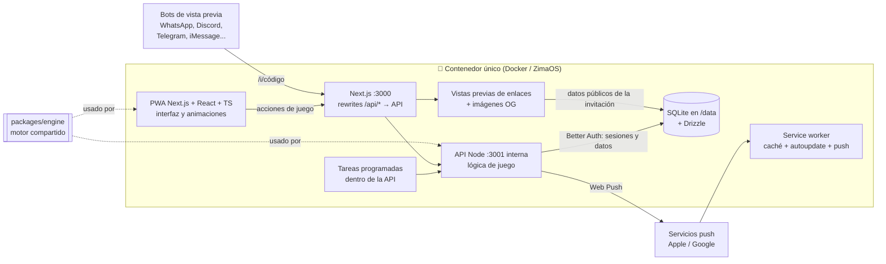
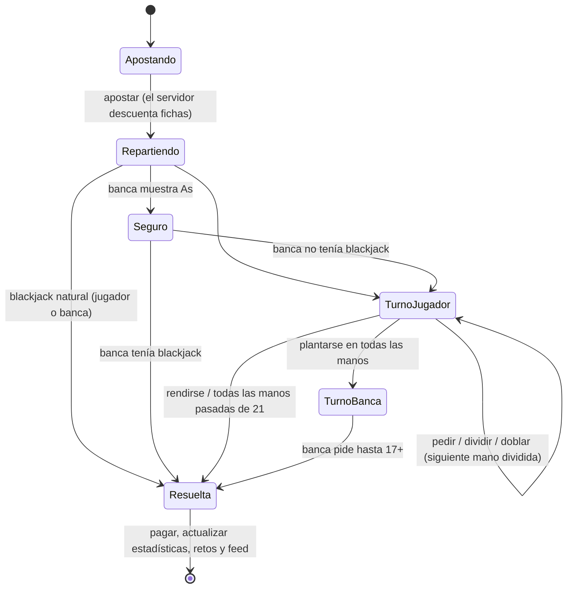
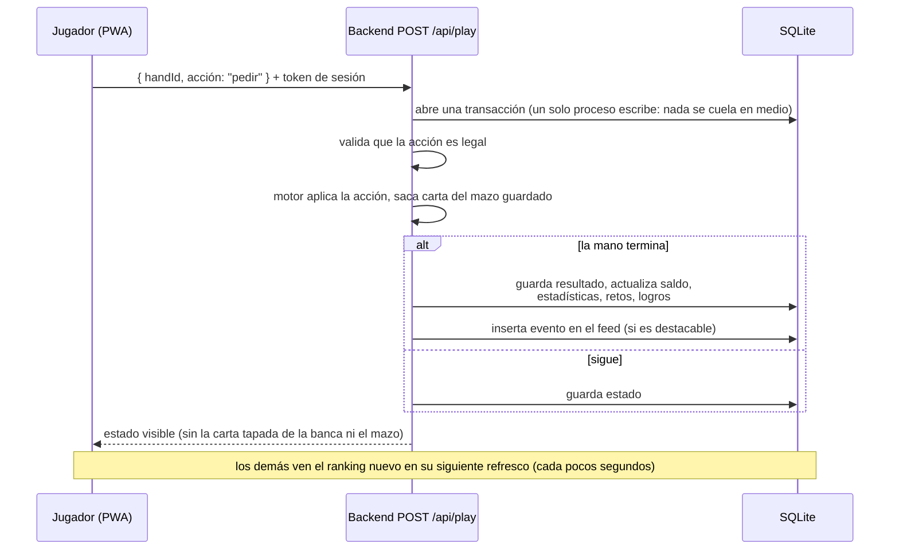
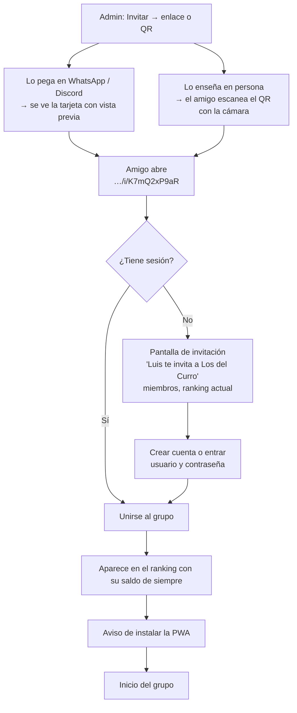
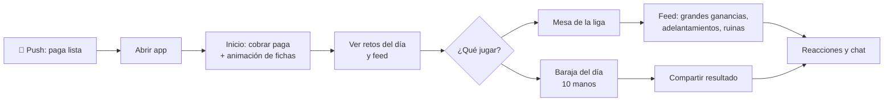
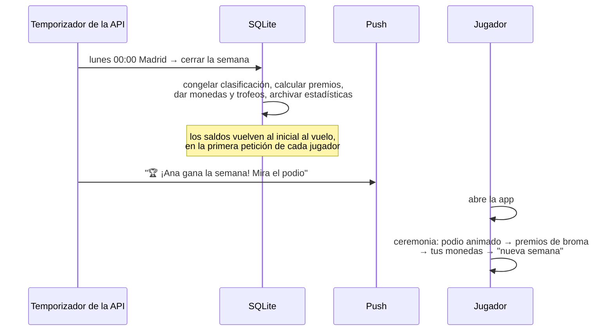

# Blackjack with Friends: documento de diseño

> Estado: **v2, decisiones confirmadas**. Los valores marcados con 🔧 son propuestas que no se han confirmado expresamente y se pueden ajustar durante la beta.

## 1. Concepto

Una **liga semanal de blackjack entre amigos**. Cada jugador juega **solo contra la banca**, a su ritmo, cuando quiera. Lo que se comparte es la competición:

- Cada jugador tiene **un único saldo de fichas**, el mismo en todos sus grupos. Juegas una sola vez y cuenta para todos.
- Los **grupos son clasificaciones**: cada grupo de amigos ordena a sus miembros por ese saldo. Puedes estar en varios grupos y en cada uno ocupas el puesto que te toque.
- Cada día recibes una **paga diaria** de fichas que se suma a tu saldo.
- El **domingo a medianoche** se cierra la semana: en cada grupo gana quien tenga **más fichas**. Hay ceremonia con podio, premios de broma y trofeo para el ganador.
- El lunes empieza un **ciclo nuevo** para todos a la vez: todos vuelven al saldo inicial y las estadísticas quedan guardadas.
- Extras: **Baraja del día** (todo el grupo juega las mismas cartas, estilo Wordle) y **retos y logros**.
- Lo social: feed de actividad, reacciones, chat de grupo y notificaciones push.
- Progresión permanente: **monedas** (distintas de las fichas) para desbloquear **estilos** de tapete, cartas, etc.

### Dos monedas, dos propósitos

| | **Fichas** 🟢 | **Monedas** 🪙 |
|---|---|---|
| Para qué | Apostar y competir en la liga | Comprar cosméticos en la tienda |
| Ámbito | Por usuario (uno solo, común a todos sus grupos) | Por usuario (global) |
| Duración | Se reinician cada semana | Permanentes |
| Cómo se ganan | Paga diaria, ganar manos | Quedar en el podio semanal, retos diarios, logros |

Separarlas es clave: gastar en la tienda **nunca** te baja en el ranking.

---

## 2. Reglas del juego

### Blackjack (reglas completas)
- 🔧 6 barajas, **barajado nuevo en cada mano** (equivale a una barajadora continua: no se pueden contar cartas).
- La banca **se planta en 17 suave** (S17).
- Blackjack paga **3:2**.
- **Doblar** solo con 9, 10 u 11 en las dos primeras cartas (`doubleOn` en `packages/engine/src/rules.ts`), también después de dividir.
- **Dividir** hasta 3 veces (4 manos). Los ases divididos reciben una sola carta.
- **Seguro** cuando la banca muestra un As (paga 2:1).
- **Rendirse** (tardío): recuperas la mitad de la apuesta.
- Sin límite de tiempo: si cierras la app a mitad de mano, la retomas donde la dejaste.

### Economía de la liga
- Todo esto lo fija **el servidor** y es igual para todos: ningún admin de grupo puede cambiar el saldo inicial, la paga ni el reinicio semanal.
- Saldo inicial cada lunes: **1.000 fichas**.
- Paga diaria: **+1.000 fichas**, se cobra con un botón (no caduca dentro de la semana: si no entras el martes, el miércoles cobras 2).
- 🔧 Apuesta mínima **10** y máxima **500** por mano, para que una sola mano no decida la semana (doblar y separar sí pueden pasar de 500).
- Si te quedas a 0, esperas a la paga del día siguiente.
- Cierre de semana: **domingo 23:59, hora de Madrid**.
- **Quien empieza a jugar a mitad de semana** recibe el saldo inicial más **todas las pagas de los días ya transcurridos** (incluido el de hoy). Empieza con lo mismo que habría tenido alguien que empezó el lunes y no jugó.
- Unirte a un grupo (o salir de él) no cambia tu saldo: solo apareces o dejas de aparecer en su clasificación.

### Premios semanales (monedas)
- 1º: **100** 🪙 + trofeo · 2º: **60** 🪙 · 3º: **30** 🪙 · Haber jugado al menos 1 día: **10** 🪙.
- **Solo cobras por tu mejor puesto**: si estás en varios grupos, recibes el premio del grupo donde mejor has quedado, no la suma. El de haber jugado se cobra una vez.
- **Un grupo solo reparte premios si tiene al menos 2 personas** que hayan jugado esa semana 🔧 (que hayan jugado, para que un amigo que nunca entra no cuente). Así no sirve de nada crear grupos vacíos para ser 1º. La ceremonia y los premios de broma se ven igual en cualquier grupo.
- Premios de broma (solo para presumir, sin monedas): más blackjacks, apuesta más loca, peor racha, más manos jugadas, "rey del seguro". Se dan en cualquier grupo; en empate se los llevan todos los empatados, salvo si empata el grupo entero (entonces no hay premio).
- Cuentan las manos de liga cerradas entre el lunes y el domingo. Los empates comparten puesto (1, 2, 2, 4).

### Baraja del día
- Todos los jugadores juegan **las mismas cartas** ese día (una sola semilla para todos), así que tu partida cuenta en todos tus grupos.
- **10 manos**, saldo virtual de 1.000 aparte de la liga y la misma apuesta fija de 100 por mano, para que solo cuenten las decisiones.
- Clasificación diaria propia en cada grupo. Premio para el 1º del día: **+50 monedas** para estilos (no fichas: no mueve la liga), como mucho una vez al día aunque seas 1º en varios grupos, y solo en grupos donde hayan jugado la baraja al menos 2 personas. Se dan al día siguiente, con la tabla del día ya cerrada, y la app lo cuenta en una ventana al abrirla.
- Al terminar, puedes compartir el resultado en el grupo, estilo Wordle: `🃏 Baraja del día #42 · +650 · 🟩🟩🟥🟩⬜🟩🟥🟩🟩🟩`.
- Hasta que acabas tus 10 manos no ves las de los demás, para que nadie te haga spoiler.
- Si te quedas sin fichas para la apuesta antes de la 10ª mano, la baraja termina ahí.
- ✅ **Hecha** (fase 9): `backend/lib/daily.ts` y `backend/routes/daily.ts`, en `/jugar/baraja` y con su tarjeta en Inicio. La semilla se crea al vuelo la primera vez que alguien la pide (y a las 00:00 de Madrid) y se guarda en `daily_decks`; cada mano sale de `semilla:n`, así que la mano n es igual para todos aunque cada uno la juegue distinto. Las partidas van en `daily_runs` (una por jugador y día, con su `version` y la mano en curso), aparte de `hands`, para que no cuenten en la liga, los retos ni las estadísticas. El día se cierra a medianoche (o en la primera petición del día siguiente): el 1º de cada grupo con al menos 2 partidas terminadas gana `DAILY_PRIZE` (50) monedas (los empates también), apuntadas en `daily_runs.premio`; al día siguiente la app lo enseña en una ventana hasta que el jugador la cierra (`POST /api/daily/seen`, `premio_visto`). La mesa de la baraja lleva un tapete propio (`DAILY_FELT` en `cosmetics/themes.ts`, petróleo con palos dibujados) que no está en la tienda, para que se note que no es la mesa de la liga, y en Inicio su icono es la carta por defecto con el número de la baraja en lugar del valor. Al acabar sale la línea para compartir fuera (con el enlace `/r/<código>` y su imagen) o publicar en el chat.

### Retos y logros
- **Retos diarios**: 3 al día, iguales para todos los jugadores (p. ej. "gana 3 manos seguidas", "haz un split ganador", "gana con 5 cartas"). Cada uno da 🪙 **monedas** (no fichas) para gastar en estilos: son un logro personal, así que no cuentan para la liga ni mueven el ranking. Uno fácil (10 🪙), uno medio (20 🪙) y uno difícil (40 🪙), sacados de un catálogo de 25 según la fecha, salvo que un admin los elija. Cada reto tiene un tipo (volumen, victorias, rachas, dobles…) y los tres del día son siempre de tipos distintos; cada nivel rota en rondas barajadas, así que un reto no vuelve hasta que han salido los demás de su nivel; el progreso sale de las manos resueltas del día (hora de Madrid) y cambian a medianoche. La cantidad se ajusta en la beta.
- **Logros** permanentes con insignia en el perfil y algunos con cosmético o monedas de premio (p. ej. "Primer blackjack", "Gana una semana", "10 semanas en el podio", "Sobrevive con 1 ficha").
- ✅ **Logros hechos** (adelantados a la fase 8): 13, con su catálogo y recompensa en `backend/lib/achievements.ts`, tabla `achievements`. Se calculan con lo que ya hay en la base de datos (manos, grupos, semanas cerradas), así que son **retroactivos**: se comprueban tras cada mano terminada, al unirse alguien a un grupo, al cerrar la semana y para todos al arrancar el servidor. Las monedas se pagan al desbloquear. "Kamikaze" y "Superviviente" necesitan el saldo de cada mano, que solo se puede reconstruir dentro de la semana en curso (las pagas de semanas pasadas se borran), así que no cuentan semanas anteriores. Los cosméticos se equipan desde Estilos (fase 10).

---

## 3. Arquitectura

### Decisión principal: el servidor reparte las cartas
El navegador **nunca** decide las cartas ni calcula premios. Solo envía acciones ("pedir", "plantarse"...) y muestra lo que el servidor responde. Así nadie puede hacer trampas tocando el código del navegador.

### Componentes



### Tecnologías

| Pieza | Elección | Por qué |
|---|---|---|
| Frontend | Next.js 16 (App Router, Turbopack) + React 19 + TypeScript | Rutas por carpetas, metadatos y vistas previas de enlaces en el propio frontend |
| Rutas | App Router de Next.js | La app es cliente tras el login; el servidor solo sirve HTML, metadatos e imágenes OG |
| Datos del servidor | TanStack Query contra nuestra `/api` | Caché, reintentos y refresco periódico (en vez de tiempo real) |
| Animaciones | Motion (antes Framer Motion) | Cartas volando, fichas, podio |
| Sonido | Howler.js | Fiable en iOS y fácil de silenciar |
| Idiomas | i18next (es + en) | Desde el día 1 |
| Backend (API) | Servidor Node/TypeScript en `backend/` (`server.ts`), solo accesible desde dentro del contenedor | La lógica de juego; Next le pasa `/api/*` |
| Base de datos | SQLite (better-sqlite3) + Drizzle ORM, un fichero en el volumen `/data` | Sin servicios aparte; migraciones en el repo, aplicadas al arrancar la API. Un solo proceso escribe, así que las transacciones son simples |
| Login | Better Auth con usuario y contraseña (sin correos) | Librería, no servicio: usuarios y sesiones en nuestra BD, cookie en nuestro dominio. El nombre de usuario es el nombre en la liga |
| Tareas programadas | Temporizador dentro de la API (o perezosas, al primer uso) | Sin servicios extra |
| Avatares | Inicial con un color propio de cada persona, o una foto subida por el jugador (el jugador elige el cuadrado 1:1 arrastrando y haciendo zoom, y se reduce a 256 px en el navegador) | Las fotos van a un mini almacén de objetos dentro del contenedor (`backend/lib/storage.ts`): ficheros en `/data/media` con claves aleatorias, servidos en `/api/media/…` con caché permanente |
| Hosting | Una imagen Docker todo en uno (`ghcr.io/ronambulo/blackjackwithfriends`): supervisord arranca la API y Next; se instala en ZimaOS con `docker-compose.yml` | Como FinanceMaster y Beergram. Solo se publica el puerto de Next, así que no hay CORS. Para la PWA hace falta HTTPS: proxy inverso o túnel delante |
| Vistas previas de enlaces | `generateMetadata` + `opengraph-image` de Next.js (`next/og`) | El HTML de cada invitación ya sale del servidor con sus metadatos e imagen |
| Códigos QR | Librería `qrcode`, generada en el navegador | Sin servidor y funciona sin conexión |
| Push | Web Push (`web-push`) con claves VAPID desde el backend; si no están en el entorno se generan una vez y se guardan en ajustes | En iPhone solo funciona con la app instalada (iOS 16.4+) |
| Tests | Vitest | Sobre todo para el motor de blackjack |

### Motor de blackjack compartido
Un único paquete TypeScript **puro**, sin dependencias, en `packages/engine/` (`@bwf/engine`). Lo usan:
- el **backend**, que es la autoridad: reparte, valida acciones y calcula pagos;
- el **cliente**, solo para mostrar (valor de la mano, qué botones están activos).

Se prueba a fondo con tests unitarios: todas las reglas y casos raros.

### Estado de una mano (máquina de estados)



Cada mano se guarda en la base de datos en cada paso. Si se recarga la app (por ejemplo, por una actualización automática), la mano sigue exactamente donde estaba.

### Flujo de una acción de juego



El mazo de cada mano se guarda en el servidor y **nunca se envía al cliente**. La carta tapada de la banca solo se envía cuando se descubre.

### Tareas programadas

| Cuándo | Qué |
|---|---|
| Lunes 00:00 Madrid | Cierra la semana (`lib/season.ts`): congela la clasificación de cada grupo, calcula podios y premios de broma, da a cada jugador las monedas de su mejor puesto más las de haber jugado y los trofeos, y archiva las estadísticas. Un temporizador de la API apunta al lunes siguiente; además, cada petición a la API comprueba primero si queda alguna semana sin cerrar (por si el servidor estaba apagado a esa hora), así que nadie llega a ver la semana nueva sin que la anterior esté cerrada. Los saldos se reinician al vuelo, como siempre. Al cerrar, la API avisa por el canal en vivo y las apps abiertas recargan todo y muestran la ceremonia. |
| Diario 00:00 Madrid | Genera la semilla de la Baraja del día. Los 3 retos no hace falta generarlos: salen de la fecha (o de la elección de un admin) y son los mismos para todos. |
| Diario 18:00 Madrid | Push: paga lista, a quien aún no la ha cobrado. |
| Domingo 21:00 | Push: "Quedan 3 horas para el cierre de la liga". |

La paga diaria **no** usa cron: se calcula al cobrarla, según los días que han pasado. Es más sencillo y no falla si el cron se retrasa.

---

## 4. Modelo de datos

```mermaid
erDiagram
  profiles ||--o{ group_members : "pertenece"
  groups ||--o{ group_members : "tiene"
  seasons ||--o{ season_results : "resultado de cada jugador"
  seasons ||--o{ season_standings : "puesto en cada grupo"
  groups ||--o{ season_standings : ""
  profiles ||--o{ hands : "juega"
  groups ||--o{ feed_events : "actividad"
  feed_events ||--o{ reactions : ""
  groups ||--o{ messages : "chat"
  profiles ||--o{ daily_deck_runs : "partidas"
  daily_decks ||--o{ daily_deck_runs : "partidas"
  profiles ||--o{ user_achievements : ""
  achievements ||--o{ user_achievements : ""
  profiles ||--o{ user_cosmetics : "colección"
  cosmetics ||--o{ user_cosmetics : ""
  profiles ||--o{ push_subscriptions : ""

  profiles {
    uuid id PK
    text nombre
    text avatar_url
    text idioma
    int monedas
    bigint saldo "fichas de la liga, una sola para todos los grupos"
    date semana "lunes de la semana a la que pertenece el saldo"
    date ultima_paga
    bigint saldo_inicio_dia "para el +/- de hoy y las flechas del ranking"
    date dia
    jsonb estilos_equipados
  }
  groups {
    uuid id PK
    text nombre
    text codigo_invitacion "10 caracteres, renovable"
    jsonb ajustes "ocultar ranking en la vista previa..."
  }
  group_members {
    uuid group_id PK
    uuid user_id PK
    text rol "admin | miembro"
  }
  seasons {
    date semana PK "lunes de la semana cerrada; solo existen las cerradas"
  }
  season_results {
    date semana PK
    uuid user_id PK
    bigint saldo_final
    jsonb estadisticas
    int monedas "las de su mejor puesto + las de haber jugado"
    int mejor_puesto "en un grupo con premios; null si ninguno"
    bool vista "ya vio la ceremonia"
  }
  season_standings {
    date semana PK
    uuid group_id PK
    uuid user_id PK
    int posicion
    bigint saldo_final
    bool con_premios "al menos 2 jugaron"
    bool trofeo
    jsonb premios "premios de broma de ese grupo"
  }
  hands {
    uuid id PK
    uuid user_id
    text modo "prueba | liga"
    bigint apuesta
    jsonb ronda "estado completo con el mazo, solo servidor"
    text fase "insurance | player | settled"
    int version
    bigint neto
  }
  daily_runs {
    uuid user_id PK
    date dia PK
    int fichas "las de la baraja, aparte de la liga"
    text resultados "una letra por mano: w l p"
    jsonb ronda "la mano en curso"
    int version
    bool terminada
    text codigo "para /r/<codigo>"
    int premio "monedas ganadas al cerrar el día"
    timestamp premio_visto "cuando la app se lo enseñó"
  }
  user_cosmetics {
    uuid user_id PK,FK
    text estilo PK "p. ej. tapete.neon"
    int monedas "lo que pagó"
    timestamptz created_at
  }
```



Notas:
- **Manos**: `ronda` guarda el estado entero del motor (mazo incluido) y nunca sale tal cual del servidor; al cliente solo le llega la vista pública. `version` evita que dos acciones a la vez se apliquen sobre la misma mano, y un índice único impide tener más de una mano abierta por jugador y modo. Se juega siempre con el saldo de la liga (`profiles.saldo`).
- **Saldo único**: el saldo y la paga viven en `profiles`, no en el grupo. El cambio de semana y de día se aplica **al vuelo**: cada petición que lee o toca el saldo comprueba `semana` y `dia`, y si son viejos devuelve el saldo a 1.000 o guarda el saldo de inicio del día. La paga no se ingresa sola: se acumula día a día y se cobra con un botón (pagas pendientes = hoy − `ultima_paga`, o desde el día antes del lunes si aún no ha cobrado ninguna esta semana). Por eso la semana se cierra **antes** de que nadie use la nueva: mientras un perfil tenga `semana` vieja, su saldo es el final de esa semana.
- **Grupos**: el admin está en `group_members.rol`, no en `groups`, así que puede haber traspaso sin tocar el grupo: si el admin se va, pasa a serlo el miembro más antiguo, y un grupo que se queda vacío se borra. Como mucho 10 grupos por jugador y 50 miembros por grupo. La clasificación usa el ranking de competición (1, 2, 2, 4). La clasificación de un grupo es una consulta de los saldos de sus miembros; al cerrar la semana se congela en `season_standings`, y `season_results` guarda lo de cada jugador una sola vez (saldo final y monedas de su mejor puesto).
- **Solo el backend toca la base de datos**: la app nunca se conecta a ella. Cada ruta de la API comprueba la sesión y que eres miembro del grupo, así que solo ves los datos de tus grupos. Los saldos, manos y monedas **solo** los cambia el backend.
- **Correcciones y avisos de fallos**: `adjustments` guarda cada corrección a mano del saldo o las monedas (cantidad, motivo y qué admin); `reports` guarda los fallos que avisan los jugadores (texto, pantalla, navegador y si está resuelto). `profiles.usuario_cambiado` es cuándo cambió el jugador su nombre de usuario por última vez.
- El campo `cosmetics.origen` deja la puerta abierta a añadir más adelante un origen "compra" sin cambiar nada más. **No hay ninguna huella visible de esto en la app.**

---

## 5. Flujos de usuario

### Primera vez: invitación → jugando



Unirse a un grupo no da ni quita fichas: el saldo es el mismo en todos los grupos. Quien empieza a jugar a mitad de semana arranca con el saldo inicial más las pagas de los días ya transcurridos (ver [Economía de la liga](#economía-de-la-liga)).

### Bucle diario



### Cierre semanal



---

## 6. Diseño UI / UX

### Principios
- **Móvil primero, en vertical**, y usable con una mano: las acciones principales quedan en el tercio inferior.
- **Estilo base moderno oscuro**: fondo casi negro, superficies con un ligero efecto de cristal, un color de acento y tipografía limpia. Es neutro para que cualquier tapete elegido quede bien.
- **Mucho "juice"**: cartas que vuelan desde el mazo, fichas que se apilan y saltan al ganar, confeti en los blackjacks, números que cuentan hacia arriba, sonidos y vibración. Todo se puede silenciar en Ajustes.
  - En iPhone, el navegador no permite vibrar desde una web; solo vibra en Android.
- Respetar "reducir movimiento" del sistema: si está activado, las animaciones se acortan.
- Español e inglés desde el inicio.

### Navegación

Barra inferior con 5 pestañas. El botón central **Jugar** es más grande. Arriba, un **selector de grupo** si perteneces a varios.

```
┌─────────────────────────────┐
│ Los del Curro ▾      🪙 240 │  ← selector de grupo · monedas
│                             │
│          (pantalla)         │
│                             │
├─────────────────────────────┤
│  🏠    👥    (🃏)    💬   👤 │
│ Inicio Grupos Jugar Social Perfil 
└─────────────────────────────┘
```

### Pantallas

**Inicio (resumen del grupo)**: de arriba abajo, tu saldo y puesto, luego "Para hoy" (Baraja del día, encuesta si hay y retos del día) y después tus amigos de la semana.
```
┌─────────────────────────────┐
│ Los del Curro ▾      🪙 240 │
│ ┌─────────────────────────┐ │
│ │ Tu saldo      12.450 🟢 │ │
│ │ 2º de 6  ▲1   ⏱ 2d 14h  │ │
│ │ [ 💰 Cobrar paga +1.000 ]│ │
│ └─────────────────────────┘ │
│ Top 3: 🥇 Ana 15.200        │
│        🥈 Tú  12.450        │
│        🥉 Luis 9.800        │
│ ┌ Retos de hoy ───── 1/3 ┐ │
│ │ ✅ Juega 10 manos  10/10│ │
│ │ ✅ Gana 3 seguidas  3/3 │ │
│ │ ⭕ Split ganador   +40🪙│ │
│ └─────────────────────────┘ │
│ [🃏 Baraja del día #42  ▶ ] │
│ Feed ─────────────────────  │
│ Luis ganó 4.000 con BJ 🔥3  │
│ Marta se arruinó 💀5        │
├─────────────────────────────┤
│  🏠    👥    (🃏)    💬   👤 │
└─────────────────────────────┘
```

**Mesa**: el tapete, las cartas, el dorso y las fichas cambian con los estilos elegidos.
```
┌─────────────────────────────┐
│ ←  Liga       12.450 🟢  🔊 │
│                             │
│       BANCA   [🂠][K♥]      │
│                             │
│      ░░░ tapete ░░░         │
│                             │
│    [A♠][7♦]   = 18 / 8      │
│      apuesta: 500           │
│                             │
│ [Rendirse] [Seguro]         │
│ [ Pedir ] [Plantarse]       │
│ [ Doblar ] [ Dividir ]      │
└─────────────────────────────┘
```
Al apostar, se toca sobre fichas de 5 / 10 / 25 / 100 / 500 / 1.000, cada valor con su color. También hay botones de "repetir apuesta", "x2" y "all-in". Después de una mano, irse a otra pantalla (Inicio, Grupos…) equivale a pulsar "Cambiar apuesta": al volver, la mesa está lista para apostar. Las fichas, las cartas, doblar, dividir y el resultado suenan con grabaciones reales y efectos cortos (pack "Casino Audio" de Kenney, "Level up, power up, Coin get" de wobbleboxx y "Casino Hit Big Money" de modusmogulus en Freesound, todos CC0, en `frontend/public/sounds`). Las fichas y cartas seguidas suben de tono al estilo Balatro; ganar, perder y blackjack tienen cada uno su sonido (una subida brillante para ganar, un golpe de gran premio de casino para el blackjack y una bajada suave para perder) y el empate es un choque de fichas. Se pueden silenciar en Ajustes.

**Grupos**: una tarjeta por grupo con tu puesto, la variación del día (▲▼) y quién va primero, más los botones de crear y unirse. Al tocar una tarjeta se abre el grupo (`/grupos/[id]`): el botón **Invitar amigos** (enlace, código y QR, en `/grupos/[id]/invitar`), la clasificación en vivo con el podio, una gráfica de líneas con el saldo de cada miembro a lo largo de la semana (de lunes a domingo; tocar o arrastrar muestra el saldo de cada uno en ese momento; `GET /api/group/history`, que reconstruye el saldo con las manos y las pagas de la semana, guardadas en la tabla `pays`, que solo conserva las de la semana en curso), la lista de miembros, los ajustes si eres admin y salir del grupo. Más adelante, el historial de semanas pasadas y la clasificación de la Baraja del día.

**Inicio**: además del saldo y la paga, las **encuestas** abiertas de los admins (se contesta con un toque y entonces se ven los porcentajes; la respuesta se puede cambiar mientras siga abierta), el ranking de la semana de tus amigos (todos los que comparten algún grupo contigo, `GET /api/ranking/friends`): el top 5, tu fila si vas más abajo y un botón para ver a todos.

**Social**: el **chat global** y el de cada grupo (se elige con el selector de arriba; una insignia en la pestaña cuenta los mensajes sin leer) y el **ranking global** de la semana (`GET /api/ranking/global`, top 100 más tu puesto). Más adelante, el **Feed** con reacciones.
- Solo se ven los mensajes de los **últimos 7 días** (tabla `messages`, `GET/POST /api/chat/:chat`, con `global` o el id del grupo). Llegan al momento por el mismo canal de eventos (SSE) que la clasificación del grupo, y cada 30 s se vuelve a pedir por si acaso.
- **Mantener pulsado** un mensaje, como en iOS, lo levanta, oscurece el resto y abre la barra de reacciones (🔥 😂 💀 👏 😱, una por persona y mensaje) y el menú con **Responder** y **Borrar**.
- **Responder**, como en WhatsApp: también arrastrando la burbuja hacia un lado (a la derecha, o a la izquierda si es tuya). La respuesta cita el mensaje (`reply_to`), y tocar la cita lleva hasta él.
- Cada uno borra sus mensajes; el admin del grupo (o un admin de la app en el global) puede borrar cualquiera.
- **Publicar mano**: las manos no se publican solas. Al acabar una, el botón con el icono de compartir (entre "Cambiar apuesta" y "Otra mano") deja elegir en qué chats se publica.

**Perfil**:
- Estadísticas de esta semana o de siempre: resultado, reparto de manos ganadas / empatadas / perdidas, neto global, manos jugadas, blackjacks, mayor ganancia, mejor racha y una gráfica de las últimas 30 manos. Se calculan a partir de las manos guardadas (`GET /api/profile/stats`). Más adelante, semanas ganadas.
- Vitrina de trofeos y logros.
- Acceso a **Estilos**.
- Botón para **compartir las estadísticas** (semana o total): genera una imagen de historia de Instagram (1080×1920, con foto, resultado, ganadas/empates/perdidas y récords, dejando libres las zonas que tapa Instagram) y la manda con el menú de compartir del sistema; donde no se pueden compartir archivos, la descarga. Al lado, un botón redondo las **publica en el chat** (global y/o grupos) como una tarjeta con el resultado, la barra de ganadas/empates/perdidas y los récords.
- Tocar el avatar cambia la foto: se abre un recortador cuadrado (arrastrar para mover; pellizcar, rueda o barra para el zoom) con el círculo del avatar marcado.

**Estilos y tienda** (`/estilos`, desde Perfil): arriba, una mesa pequeña con lo que llevas puesto y lo que estás mirando, con cartas, dorso, fichas y tu avatar con el marco. Debajo, la barra del elegido (ponérmelo, comprar por X 🪙 con confirmación, o cuánto te falta) y una cuadrícula por tipo (tapete, cartas, dorso, fichas, marco de avatar). Cada elemento está puesto, es tuyo, tiene precio o está bloqueado; si está bloqueado, se indica cómo conseguirlo ("Gana una semana" o "Logro «Medianoche»").

**Ceremonia semanal**: a pantalla completa y en secuencia: redoble → 3º → 2º → 1º con confeti → premios de broma → "has ganado X 🪙" → "¡Nueva semana!".

**Ajustes**: foto, nombre y **nombre de usuario** (3–20 letras, números, `_` o `.`; no puede ser el de un admin y los admins no se lo cambian; después de cambiarlo hay que esperar 30 días para volver a hacerlo, y mientras tanto se ve la fecha), idioma, sonido, vibración, notificaciones (por tipo), **Ayuda** y cerrar sesión. En Ayuda están las **Novedades** (`/novedades`: lo nuevo de cada versión, escrito en `frontend/src/changelog/entries.ts`; cuando hay una versión que el dispositivo no ha visto sale una barra arriba) y **Avisar de un fallo** (un texto de 5 a 1.000 caracteres que llega al panel con la última pantalla y el navegador; como mucho 5 al día). Si eres admin, también los ajustes del grupo: expulsar miembros, ocultar el ranking en la vista previa y renovar el enlace de invitación. La paga, el saldo inicial y el reinicio semanal los fija el servidor y no se pueden cambiar por grupo.

**Administración** (`/admin`, enlace desde Perfil y, en escritorio, al pie de la barra lateral): solo para los usuarios de la variable `ADMIN_USERNAMES` (en el `docker-compose.yml`); para el resto la API responde 404.
- **Estadísticas**: usuarios, grupos, jugadores por grupo, jugadores al día y en la semana, tiempo jugado, manos, apuesta media y máxima, fichas apostadas y pagadas, neto de la banca, actividad de 14 días, tamaño de las apuestas, tops (semana, histórico, monedas, manos, apostado) y grupos más grandes. Se pueden **exportar a CSV** (para Excel o Google Sheets) los jugadores, uno por fila, los días desde el principio y **todas las manos** de todos (fecha, jugador, modo, apuesta, neto, cartas del jugador y de la banca, resultado, doblada, separada y seguro). Más adelante, los cosméticos más usados y comprados.
- **Usuarios**: buscar por usuario, nombre o IP; ver saldo, manos, grupos, monedas, alta, última conexión e IP; **cambiar el nombre y el usuario**; **corregir el saldo de la semana o las monedas** (sumar o restar, siempre con motivo; nunca deja a nadie en negativo y queda la lista en su ficha y en el registro); **borrar la cuenta** y **bloquear sus IPs** (tabla `ip_bans`; una IP bloqueada recibe 403 en toda la API). También se puede bloquear o desbloquear una IP a mano.
- **Moderación**: **cola de revisión** de fotos y nombres nuevos (tabla `reviews`; se ven ya mientras tanto; "Rechazar" quita la foto o devuelve el nombre al usuario); comportamiento raro (rachas, ritmo de bot, cuentas en cadena) con "Bloquear…" e "Ignorar"; cuentas que comparten conexión; **bloqueos con caducidad** (24 h, 7 días, 30 días o para siempre), por IP o por `@usuario`, con motivo y quién lo puso.
- **Economía**: fichas en juego, paga repartida, lo que se queda la casa, monedas; saldos actuales por tramos; resultados vistos frente a los esperados; **monedas para todos** (dar o quitar la misma cantidad a todos de golpe, con motivo y confirmación; a quien tenga menos de lo que se quita se le queda en 0, y a cada uno le queda apuntado en su ficha); **reglas editables** (saldo inicial y paga diaria, tabla `economy_rules`): un cambio se guarda para el lunes siguiente y la semana en curso no se toca.
- **Liga**: la temporada en curso con su cuenta atrás (la semana 1 es la de la primera mano jugada), los grupos de la semana y los **retos diarios** (los de hoy con cuántos los han completado y un selector para los de mañana, que vuelven a los de la fecha con un botón).
- **Avisos y notificaciones**: a quién llegamos (jugadores de los últimos 30 días por plataforma, con la app instalada o solo en el navegador, con notificaciones y cuántos dispositivos); **avisos** que salen arriba en la app (tabla `notices`), ahora o programados, durante 24 h, 7 días o hasta quitarlos (los marcados como **importantes**, `notices.importante`, salen en una ventana al abrir la app en vez de en la franja de arriba, después de la ceremonia de la semana y nunca en la mesa), con cuántos los han visto y cuántos los cerraron (`notice_views`); y **notificaciones push** (tabla `push_campaigns`), ahora o programadas, con título, texto y la pantalla que abren, y cuántos dispositivos las recibieron. Cada aviso o notificación va a una audiencia: todos, iPhone/iPad, Android, ordenador, con la app instalada, sin ella, con notificaciones o sin ellas (esta última solo para avisos). Cada dispositivo dice lo que es al abrir la app (`POST /api/devices`, tabla `devices`); los avisos se filtran en el propio dispositivo y las notificaciones en el servidor, solo a quien tiene activado el tipo "Novedades".
- **Encuestas**: preguntas de 2 a 6 respuestas (tablas `polls` y `poll_votes`), con plantillas sobre las reglas (límite por mano, paga diaria, fichas de la semana, duración de la liga), abiertas 24 h, 3 días, 7 días o hasta cerrarlas, y con notificación push opcional; los resultados y la participación frente a los jugadores activos, y botones para cerrar y borrar.
- **Sistema**: estado general, tiempo encendido, latencia p95 y errores (en memoria, desde el último arranque), base de datos, fotos y última copia; **interruptores** (altas nuevas, mesa abierta, unirse a grupos; tabla `settings`); **copias de seguridad** diarias de la base de datos (se guardan las 14 últimas), "Hacer copia ahora" y **descargar** la base de datos (una copia nueva o cualquiera de las guardadas) y **restaurar** una copia guardada (antes se hace una copia de cómo está, y quien entró después tiene que volver a entrar); **avisos de fallos** de los jugadores, con "Resuelto", "Reabrir" y "Borrar"; **modo mantenimiento** con un mensaje opcional: la API responde 503 a todo salvo a los admins, el estado (`/api/status`) y el propio panel, los jugadores ven una pantalla de "Volvemos enseguida" que se abre sola al terminar y los admins una franja roja arriba; rutas más lentas, errores recientes y el **registro de lo que hacen los admins** (tabla `admin_log`).
- **Tienda**: los estilos en una cuadrícula por tipo (Tapetes, Dorsos, Cartas, Fichas, Marcos), en el orden de la tienda, con filtros (todos, a la venta, retirados, con oferta) y una pestaña de **Estadísticas** (monedas por tipo, los más vendidos, los más llevados y los que más monedas han dado, y cuántos a la venta no ha comprado nadie). Al pulsar un estilo se abre una ventana (una hoja desde abajo en el móvil) para **cambiar el precio** o volver al de serie, ponerle una **oferta** (más barata que el precio), **moverlo** antes o después (el gratis va siempre primero) y **ponerlo a la venta o retirarlo**. Todos los estilos de la tienda **salen retirados** hasta que un admin los pone a la venta; los gratis, los de logros y los de trofeos no se pueden retirar. Quien tiene un estilo retirado lo conserva y puede llevarlo; comprarlo responde 410, y un precio que ha cambiado mientras mirabas, 409. Una **rebaja** en toda la tienda (un porcentaje, como mucho un 90 %) se gana a las ofertas solo si deja el precio más bajo. Se guarda en `settings` (`shop`), encima del catálogo del código, así que un estilo nuevo aparece solo (retirado). La pestaña del panel va en la dirección (`?tab=`), así que al recargar se queda donde estabas.

#### Administración: pendiente

- Notas privadas de los admins en la ficha de cada jugador.
- Más reglas editables: apuesta mínima y máxima, monedas por puesto y por reto.
- Avisos y notificaciones solo para un grupo o un idioma.
- Guardar las métricas entre reinicios y avisar cuando suben los errores.

### Cosméticos (catálogo y precios)
✅ Hechos (fase 10). El catálogo y los precios están en `backend/lib/cosmetics.ts`; el aspecto de cada estilo, en `frontend/src/cosmetics/themes.ts` (variables CSS que el marco de la app aplica a toda la app y que la tienda pone en cada vista previa). Solo se guarda en `user_cosmetics` lo comprado: lo gratis, lo de logros y lo de trofeos se calcula al vuelo. Lo que lleva cada jugador está en `profiles.estilos_equipados`; el marco viaja con su nombre en rankings y chat, así que lo ven los demás.

El precio sube con lo que cambia el estilo. Lo que se gana a la semana:

| Fuente | 🪙 por semana |
|---|---|
| Retos diarios (10 + 20 + 40 al día) | hasta 490; ~300 haciendo el fácil y el medio cada día y el difícil a veces |
| Cierre de la semana (10 por jugar + 100 / 60 / 30 por el podio, el mejor puesto entre tus grupos) | 10-110; ~50 de media en un grupo de 5 |
| Baraja del día (50 al 1º de cada grupo, al día siguiente) | hasta 350; ~70 de media en un grupo de 5 |
| Logros (una sola vez) | ~750 en total |

Un jugador activo saca unas **400 🪙 a la semana** y uno que lo hace todo y gana mucho, hasta ~950. Así, un color cuesta un par de días, un diseño una semana, lo legendario unas dos semanas y media y lo mítico, lo más difícil, un mes (menos de dos semanas como muy pronto). Todo el catálogo junto son unas 24.700 🪙.

| Nivel | 🪙 | Tapete | Cartas (cara y forma) | Dorso | Fichas | Marco |
|---|---|---|---|---|---|---|
| Gratis | 0 | Verde casino | Clásicas | Rojo | Casino | Sin marco |
| Color | 100 | Azul, Burdeos, Morado, Grafito, Turquesa, Coral, Oliva, Abismo, Musgo | Pastel | Azul, Verde, Negro, Morado, Abismo, Musgo | Retro | Bronce, Plata, Hierro, Cobre |
| Estampado | 200 | Madera, Escocés, Riviera, Mármol, Vichy | Cuatro colores (cada palo en una carta de su color), Vintage | Rombos, Retro, Carbono | Pastel, Blanco y negro, Obsidiana, Bosque, Océano | Oro, Oro rosa, Cromo, Océano |
| Diseño | 400 | Píxel, Obsidiana, Ondas | Noir, Neón, Sakura (las clásicas en rosa, con flores), Sangre, Acero | Art déco, Píxel, Obsidiana | Neón, Industrial | Neón, Fuego, Hielo, Hiedra, Sombra |
| Especial | 600 | Galaxia | Cristal (como las de Balatro) | Cristal | Píxel (sprites en `public/styles/fichas-pixel`; la de 1.000 es un payaso) | Arcoíris, y con adornos fuera del aro (`ui/Avatar.tsx`): Diablillo, Flores, Ángel, Órbita |
| Legendario | 1.000 | Montecarlo (con marquetería de oro) | | | Gemas (talla esmeralda, un color por valor) | Diamante |
| Mítico | 1.600 | Holográfico | | | | Corona |
| Logro | | Medianoche (100 blackjacks) | | Kamikaze (all-in ganado) | | |
| Trofeos | | Campeón (1 semana) | | | | Laurel (5 semanas) |

Al comprar se paga y se equipa a la vez; si no llegan las monedas, la API responde 402 y no cobra nada (la resta es atómica).

---

## 7. Lado social

| Función | Detalle |
|---|---|
| Grupos | El creador es admin. Se entra por enlace de invitación (renovable). Puedes estar en varios grupos; tu saldo es el mismo en todos y cada grupo es una clasificación. |
| Feed | Eventos automáticos destacables: blackjack con apuesta alta, ganancia o pérdida grande, adelantamiento en el ranking, ruina, reto o logro completado, resultado de la Baraja del día. |
| Reacciones | 🔥 😂 💀 👏 😱 en cada evento del feed. |
| Chat | Global y por grupo, de los últimos 7 días; texto y emojis, reacciones, respuestas citando un mensaje y actualización al momento (SSE). Más adelante, citar eventos del feed. |
| Push | Paga lista (si no has cobrado a las 🔧 18:00), te han adelantado (alguien de tu grupo te pasa en la semana; como mucho uno por hora y persona), mención con @ en el chat, quedan 3 h de liga (si has jugado esa semana), ceremonia lista y moderación (te rechazan el nombre o la foto). Cada tipo se activa o desactiva por separado en Ajustes; el interruptor del dispositivo va aparte. |
| Compartir fuera | Estadísticas del perfil como historia de Instagram (ya disponible), resultado de la Baraja del día y podio semanal como texto o imagen para WhatsApp. |
| Compartir en el chat | Publicar una mano jugada o tus estadísticas (semana o total) en los chats que elijas (ya disponible). Más adelante, los mensajes a una persona. |

Moderación mínima: el admin puede expulsar miembros y borrar mensajes del chat de su grupo, y cualquiera puede borrar sus propios mensajes.

### Invitar: enlace con vista previa y QR

**Pantalla "Invitar"** (desde el Inicio del grupo o desde sus ajustes):
```
┌─────────────────────────────┐
│ ←  Invitar a Los del Curro  │
│                             │
│      ┌───────────────┐      │
│      │ ▀▄█▀▄ ▄▀█▄▀▄  │      │
│      │ █▄▀ [🃏] ▀▄█  │      │  ← QR con el icono de la app en el centro
│      │ ▄▀█▄▀▄ █▀▄▀█  │      │
│      └───────────────┘      │
│   Escanéalo con la cámara   │
│                             │
│ …/i/K7mQ2xP9aR    │
│ [ 📤 Compartir ] [ 📋 Copiar]│
│ [ ⬇️ Guardar QR como imagen ]│
│                             │
│ Admin: [ 🔄 Renovar enlace ] │
└─────────────────────────────┘
```
- **Compartir** abre el menú nativo del móvil (WhatsApp, Telegram...). Si no está disponible, copia el enlace.
- El **QR** se genera en el propio navegador con el estilo oscuro de la app y el icono en el centro. Se puede guardar como imagen.
- Para escanearlo no hace falta lector dentro de la app: basta la cámara del móvil, que abre el enlace.
- **Renovar enlace** invalida el anterior (y su QR). Sirve si se ha filtrado.
- Si quien abre el enlace no tiene cuenta, primero se registra (o inicia sesión) y elige nombre. La invitación se guarda en el dispositivo durante 24 h y, al entrar, la app le lleva directamente a la pantalla de unirse a ese grupo.

**Vista previa del enlace** (la tarjeta que aparece al pegarlo en WhatsApp, Discord, Telegram, iMessage, X...):

```
┌──────────────────────────────────────────┐
│ Blackjack with Friends                    │
│ Luis te invita a «Los del Curro» 🃏        │  ← og:title
│ 6 jugadores · Semana 12 · Líder: Ana       │  ← og:description
│ ┌──────────────────────────────────────┐ │
│ │  [tapete verde]                       │ │
│ │   LOS DEL CURRO                       │ │  ← og:image 1200×630
│ │   (avatares de los miembros)          │ │     generada al vuelo
│ │   🥇 Ana 15.200 🥈 Pablo 12.450 🥉 …   │ │
│ │   ¡Únete a la liga!         🃏 logo    │ │
│ └──────────────────────────────────────┘ │
└──────────────────────────────────────────┘
```

Cómo funciona:
- Los bots que generan la vista previa **no ejecutan JavaScript**: solo leen las etiquetas `<meta>` del HTML que devuelve el servidor.
- Por eso, las rutas que se comparten (`/i/[código]`) son páginas de Next.js renderizadas en el servidor, fuera del grupo `(app)` que exige login:
  1. Pide al backend los datos públicos de la invitación (nombre del grupo, quién invita, número de miembros y top 3) mediante una función de solo lectura que no expone nada más.
  2. `generateMetadata` rellena las etiquetas Open Graph y de Twitter. Para una persona, la app carga con normalidad. Para un bot, la tarjeta queda bonita.
  3. `og:image` sale de `opengraph-image.tsx` en esa misma ruta, que dibuja la imagen 1200×630 con `next/og`.
- En Discord, el color de la barra lateral de la tarjeta sale de `theme-color`.
- La URL de la imagen tiene que ser absoluta: se construye con `SITE_URL` o, si no está, con `BETTER_AUTH_URL` (el dominio público).
- Las respuestas se guardan en caché unos minutos, para no consultar la BD cada vez que alguien pega el enlace.
- **Página principal y enlaces genéricos**: tarjeta estática con el logo y "Tu liga semanal de blackjack con amigos".
- **Otros enlaces compartibles** que reutilizan el mismo sistema: el resultado de la Baraja del día (`/r/…`) y el podio semanal (`/p/…`), cada uno con su imagen generada.

Privacidad y seguridad:
- Cualquiera con el enlace ve en la vista previa el nombre del grupo, los nombres del top 3 y el número de miembros. Por eso:
  - el código es **largo y aleatorio** (10 caracteres), para que no se pueda adivinar;
  - el admin puede **renovarlo**;
  - 🔧 hay un ajuste de grupo para **ocultar el ranking en la vista previa** (solo nombre del grupo y número de miembros).
- Si el código no existe o se ha renovado, la tarjeta es la genérica y la página dice "Invitación caducada, pídele otra a tu amigo".

---

## 8. Fases de desarrollo

Cada fase termina con algo usable y desplegado.

| # | Fase | Resultado |
|---|---|---|
| 0 | ✅ PWA base | Instalación con aviso y botón, y actualización automática |
| 1 | ✅ Fundaciones | Base de datos + Drizzle; login con usuario y contraseña (Better Auth); i18n; estilo base oscuro; navegación con pestañas; despliegue; tarjeta de vista previa estática para la página principal |
| 2 | ✅ Motor de blackjack | Módulo puro con todas las reglas y una batería completa de tests |
| 3 | ✅ Mesa jugable | endpoint `POST /api/play` del backend, manos guardadas en BD y mesa con animaciones básicas, todavía con un saldo de prueba |
| 4 | ✅ Grupos y liga | Saldo único de liga y paga diaria; crear grupo, unirse, ranking en vivo de cada grupo y admin |
| 4b | ✅ Invitaciones | Pantalla "Invitar" con compartir, copiar y **QR**; **vista previa del enlace** con imagen generada (`next/og`); renovar el enlace |
| 5 | ✅ Ciclo semanal | Cierre automático, ceremonia, estadísticas, trofeos y monedas |
| 6 | 🟡 Social | ✅ Chat global y por grupo con reacciones, respuestas y publicar manos y estadísticas. Falta: feed y mensajes a una persona |
| 7 | ✅ Notificaciones push | Suscripción por dispositivo, preferencias por tipo en Ajustes y envíos (paga, adelantamientos, menciones, cierre, ceremonia y moderación) |
| 8 | ✅ Retos y logros | Retos diarios en Inicio con aviso en la mesa al completarlos y gestión en Administración; dan monedas para estilos, nunca fichas |
| 9 | ✅ Baraja del día | Semilla diaria, 10 manos, clasificación y compartir (con su vista previa `/r/…`) |
| 10 | ✅ Estilos y tienda | Sistema de temas para la mesa, colección, tienda y selector; en Administración, los cosméticos más usados y comprados |
| 11 | Juice y pulido | Más sonidos (los básicos de la mesa ya están), más animaciones, vibración, accesibilidad y rendimiento |
| 12 | Beta con amigos | Probar con un grupo real, ajustar la economía y corregir errores |

Para empezar a probar con amigos de verdad bastan las fases 1–5 (incluida la 4b). El resto se va añadiendo semana a semana sin que nadie tenga que reinstalar nada.

---

## 9. Decisiones tomadas

| Tema | Decisión |
|---|---|
| Saldo inicial semanal / paga diaria | 1.000 / 1.000 fichas |
| Apuesta mínima / máxima | 10 / 500 fichas por mano |
| Quien entra a mitad de semana | Saldo inicial + todas las pagas de los días ya transcurridos |
| Cierre de semana | Domingo 23:59, hora de Madrid |
| Baraja del día | 10 manos con apuesta fija; el 1º del día gana +50 monedas para estilos, al día siguiente |
| Saldo | Uno por jugador, común a todos sus grupos; los grupos son clasificaciones |
| Premios en monedas | 100 / 60 / 30 para el podio, 10 por haber jugado; solo cuenta tu mejor puesto y el grupo necesita al menos 2 personas que hayan jugado |
| Premio de los retos diarios | Monedas para estilos, no fichas: los retos son personales y no deben dar ventaja en la liga |
| Nombre | Blackjack with Friends |
| Dominio | El del servidor casero (ZimaOS), con HTTPS por proxy inverso o túnel |
| Invitaciones | Enlace con vista previa enriquecida + código QR |
| Login | Usuario y contraseña, sin correos (sin Google ni Apple) |
| Estructura | Monorepo con npm workspaces: `frontend/`, `backend/` y `packages/engine/`; frontend y backend van juntos en una imagen Docker (`docker/`) |
